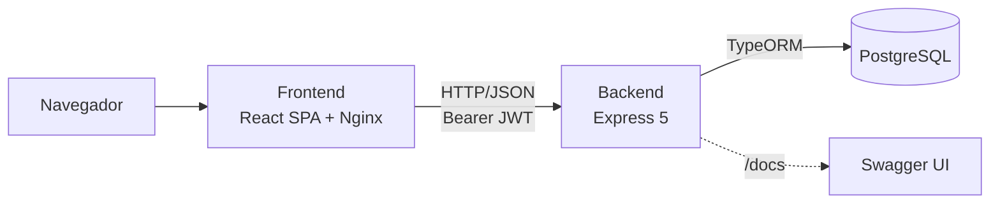
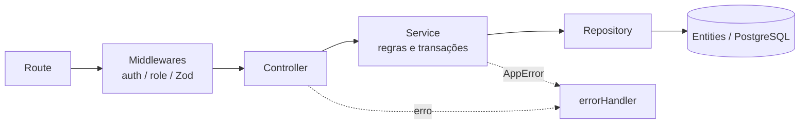
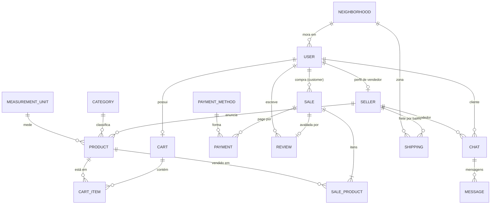

# Arquitetura do Backend — VerdeAr

Este repositório (`VerdeAr/backend`) contém a API RESTful que substitui a camada de backend do monolito legado [`VerdeAr/Verdear`](https://github.com/VerdeAr/Verdear). O frontend consumidor é o repositório irmão [`VerdeAr/frontend`](https://github.com/VerdeAr/frontend).

O VerdeAr é um marketplace que conecta produtores familiares e orgânicos (**Vendedores**) a consumidores (**Clientes**). O glossário e as regras de negócio completas (RN-01 a RN-53) estão no Notion, na página *Regras de Negócio & Glossário*.

---

## 1. Status da migração do monólito

Escopo migrado e ativo:

| Domínio | O que existe |
|---|---|
| Autenticação e perfis | `User` com papel `CLIENTE` ou `VENDEDOR`; `Seller` como perfil estendido (1:1) com CNPJ, nome da fazenda e descrição. Senha com bcrypt, sessão com JWT. |
| Catálogo | `Product`, `Category` e `MeasurementUnit`. Busca pública paginada e CRUD restrito ao vendedor, com estoque e status ativo/inativo. |
| Carrinho | `Cart` e `CartItem` persistidos no banco (um carrinho por usuário), com frete calculado por produtor. |
| Checkout | `Sale`, `SaleProduct` e `Payment` criados em uma transação, com lock pessimista de estoque. |
| Pedidos do vendedor | Listagem filtrável por status, contador de pendentes e mudança de status com estorno de estoque no cancelamento. |
| Avaliações | Criação por clientes em vendas finalizadas e listagem pública por vendedor ou produto. |
| Documentação | OpenAPI 3.0 em `/docs`, `/api-docs` e `/api-docs.json` (ver limitações na seção 11). |

Modelado, mas **sem endpoints** hoje: `Shipping` (frete por bairro). A comunicação e tempo real com `Chat` e `Message` está implementada via Socket.io e endpoints REST em `/chats` (VER-58/VER-59).

---

## 2. Stack tecnológica

| Camada | Tecnologia |
|---|---|
| Runtime | Node.js (imagem Docker `node:22-alpine`) + npm |
| Linguagem | TypeScript em modo `strict` (alias `@/*` para `src/*`) |
| Framework HTTP | Express 5 |
| Banco de dados | PostgreSQL (extensão `uuid-ossp`, chaves primárias UUID) |
| ORM | TypeORM, com `synchronize: false` e migrations versionadas |
| Autenticação | `jsonwebtoken` (JWT, 7 dias) + `bcrypt` (10 rounds) |
| Validação | Zod 4, com DTOs inferidos por `z.infer` e `cpf-cnpj-validator` |
| Documentação | `swagger-ui-express` com especificação em `src/config/swagger.ts` |
| Qualidade | Biome (lint e formatação) |
| Git hooks | Husky + Commitlint (`@commitlint/config-conventional`) |
| Container | Docker multi-stage (`builder` e `runner`) |
| Configuração | `dotenv` |

---

## 3. Visão de sistema



O backend é um serviço único e sem estado de sessão no servidor. A identidade vem do JWT enviado em cada requisição.

---

## 4. Estrutura de pastas

```
src/
├── app.ts             # Monta o Express: CORS, JSON, cookies, logging, Swagger, rotas, errorHandler
├── server.ts          # Inicializa o DataSource e sobe o servidor na PORT
├── config/            # database.ts (DataSource TypeORM) e swagger.ts (OpenAPI)
├── controllers/       # Recebem a requisição, validam com Zod e delegam aos services
├── entities/          # Entidades TypeORM, enums.ts e index.ts
├── errors/            # AppError (mensagem, status HTTP e lista de erros)
├── middlewares/       # auth, validation, logging e error
├── migrations/        # Migrations versionadas
├── repositories/      # Repositórios TypeORM estendidos com queries especializadas
├── routes/            # Uma rota por recurso, agregadas em routes/index.ts
├── schemas/           # Schemas Zod e tipos inferidos
├── seeds/             # initial.seed.ts (dados essenciais, idempotente)
├── services/          # Regras de negócio e transações
└── types/             # express.d.ts (adiciona req.user)
```

Outros arquivos relevantes na raiz: `Dockerfile`, `entrypoint.sh`, `biome.json`, `commitlint.config.mjs`, `.husky/`, `.env.example`.

---

## 5. Camadas e fluxo de uma requisição



1. **Route:** define método, caminho e a cadeia de middlewares.
2. **Middlewares:** `ensureAuthenticated` valida o JWT e preenche `req.user`; `ensureRole([...])` confere o papel; `validate(schema)` aplica Zod ao corpo.
3. **Controller:** extrai e valida parâmetros, query e corpo com Zod e chama o service. Não contém regra de negócio nem acessa o banco.
4. **Service:** concentra as regras, os cálculos e as transações (`AppDataSource.transaction`).
5. **Repository:** único ponto de acesso ao TypeORM, com queries especializadas (`findFiltered`, `findByIdWithDetails` etc.).

A ordem dos middlewares globais em `app.ts` é: CORS, `express.json()`, `cookie-parser`, logging, rotas do Swagger, router principal e, por último, `errorHandler`.

---

## 6. Modelo de dados



Pontos importantes do modelo:

- **Chaves:** todas as tabelas usam `uuid` e têm `created_at` e `updated_at`.
- **Quantidades e preços:** `stock` e `quantity` são `numeric(10,3)` (aceitam frações, como 0,5 kg); `price`, `unit_price`, `total_amount` e `fixed_shipping_rate` são `numeric(10,2)`.
- **Unicidade:** `users.email`, `users.cpf`, `sellers.user_id`, `carts.user_id`, `categories.name`, `measurement_units.name` e `payment_methods.description`. O CNPJ é verificado como único pelo `AuthService`, não por constraint.
- **Enums no banco:** `users_role_enum` (`CLIENTE`, `VENDEDOR`), `carts_delivery_type_enum` e `sales_delivery_type_enum` (`ENTREGA`, `RETIRADA`), `sales_status_enum` (`ABERTA`, `FINALIZADA`, `CANCELADA`) e `chats_status_enum` (`ATIVO`, `FINALIZADO`).
- **Integridade referencial:** `sales.customer_id` e `sale_products.product_id` usam `ON DELETE RESTRICT`, preservando o histórico de pedidos. As demais relações usam `CASCADE` ou `SET NULL`.
- **Avaliação única por venda:** garantida na camada de service; não há constraint `UNIQUE` em `reviews.sale_id`.
- **Frete fixo:** fica em `users.fixed_shipping_rate` (inicia em R$ 0,00 para vendedores).
- **Migrations:** hoje existe uma única migration (`InitialSchema1790124561841`), registrada manualmente em `config/database.ts`. Novas migrations precisam ser adicionadas à lista `migrations` do DataSource.

---

## 7. Autenticação e autorização

- **Emissão:** `POST /auth/register` e `POST /auth/login` gravam o JWT em um cookie `token` (`httpOnly`, `sameSite: lax`, `secure` apenas em produção, validade de 7 dias). O frontend depende exclusivamente desse cookie (VER-74): o token não fica acessível a JavaScript, então não está em `localStorage` nem em `document.cookie`.
- **Leitura:** `ensureAuthenticated` lê o token do cookie `token`. O cabeçalho `Authorization: Bearer <token>` continua aceito como alternativa para clientes de API e para o botão *Authorize* do Swagger.
- **Payload do JWT:** `{ id, role }`, com expiração de 7 dias. Não há refresh token.
- **Resposta de erro:** 401 para token ausente, inválido ou expirado; 403 quando o papel não é permitido.
- **Logout:** `POST /auth/logout` limpa o cookie no servidor. Um token já emitido continua válido até expirar, pois não há revogação.
- **CORS:** origens liberadas por `CORS_ORIGIN` (separadas por vírgula), com `credentials: true`, necessário para o navegador enviar o cookie (`withCredentials` no frontend). Como o cookie é `SameSite=Lax`, frontend e API devem ficar no mesmo site. Sem a variável, o padrão é `localhost:5173`, `localhost:3000` e `127.0.0.1:5173`.

### Matriz de acesso

| Recurso | Público | Cliente | Vendedor |
|---|:-:|:-:|:-:|
| Vitrine (`/produtos`), `/categorias`, `/bairros`, `/unidades-medida` | ✔ | ✔ | ✔ |
| Listar avaliações por vendedor ou produto | ✔ | ✔ | ✔ |
| Registro, login e logout | ✔ | ✔ | ✔ |
| `/auth/me`, `/pessoa/cadastro`, `/pessoa/senha` | | ✔ | ✔ |
| Carrinho, checkout, histórico de compras | | ✔ | ✔ |
| Criar avaliação | | ✔ | ✔ |
| `/pessoa/frete` | | | ✔ |
| `/vendedor/produtos` (CRUD, ativar/desativar) | | | ✔ |
| `/vendedor/pedidos` e mudança de status | | | ✔ |

---

## 8. Regras de negócio implementadas

### Cadastro e perfil
- CPF validado e normalizado para 11 dígitos; e-mail, CPF e CNPJ duplicados retornam 409.
- Senha com no mínimo 6 caracteres. O papel é definido no cadastro; o perfil `Seller` é criado automaticamente para vendedores.
- A troca de senha exige a senha atual correta.

### Catálogo
- A vitrine pública só lista produtos **ativos e com estoque maior que zero** (`disponivel=true` por padrão).
- Busca por nome ou descrição, sem diferenciar maiúsculas e minúsculas. Paginação com `page` e `limit` (padrão 12) e ordenação por `name`, `price` ou `created_at`.
- O detalhe de produto retorna 404 se estiver inativo ou sem estoque e inclui estatísticas de avaliação.
- O vendedor só edita, ativa ou desativa produtos do próprio perfil (403 caso contrário).
- **Exclusão:** o produto é removido do banco; se houver vendas vinculadas (`RESTRICT`), ele é apenas desativado e a API informa isso na resposta.

### Carrinho e frete
- Um carrinho por usuário, criado sob demanda. O preço do item é atualizado ao adicionar ou alterar quantidade.
- Não aceita produto inativo, esgotado ou quantidade acima do estoque.
- O **frete é calculado por produtor**: na modalidade `ENTREGA`, soma-se o `fixed_shipping_rate` de cada vendedor distinto presente no carrinho. Em `RETIRADA`, o frete é R$ 0,00. O bairro do usuário não entra no cálculo.
- A forma de pagamento preferida é salva no carrinho como texto.

### Checkout
Executado em uma única transação (`SaleService.checkout`):

1. Carrega o carrinho e rejeita carrinho vazio.
2. Define entrega (corpo ou carrinho) e pagamento (corpo, carrinho ou `Dinheiro` como padrão).
3. Para cada item, aplica `pessimistic_write` no produto, valida existência, status ativo e estoque, e decrementa o estoque.
4. Calcula subtotal, frete por produtor e total.
5. Cria `Sale` (`ABERTA`), `SaleProduct` com o preço unitário congelado e `Payment`.
6. Esvazia o carrinho. Qualquer falha desfaz tudo.

### Pedidos
- O vendedor vê apenas pedidos que contêm produtos seus, com o subtotal da sua parte e o total do pedido.
- Transições: `ABERTA → FINALIZADA` ou `ABERTA → CANCELADA`, feitas só por vendedor com produto no pedido. Estados finais não mudam.
- No cancelamento, o estoque dos itens é devolvido sob lock pessimista, na mesma transação.

### Avaliações
- Só o cliente dono da venda avalia, apenas vendas `FINALIZADA` e uma vez por venda.

---

## 9. Tratamento de erros e observabilidade

| Situação | Resposta |
|---|---|
| `AppError` (regra de negócio) | Status do erro (400, 401, 403, 404, 409) com `{ success: false, message, errors? }` |
| `ZodError` (validação) | 400 com `message` e `errors: [{ field, message }]` |
| Erro inesperado | 500 com mensagem genérica; o stack trace vai apenas para o log |

- A validação roda em dois estilos: o middleware `validate(schema)` (auth e pessoa) e `schema.parse` dentro dos controllers (produtos, carrinho, vendas, avaliações). Em ambos, o `ZodError` cai no `errorHandler`.
- `loggingMiddleware` registra cada requisição como `[HTTP] MÉTODO URL STATUS - Nms`, com cor por faixa de status.

---

## 10. Diretrizes arquiteturais

1. **Separação de responsabilidades:** controllers sem regra de negócio nem queries; services com as regras; repositories como único acesso ao TypeORM.
2. **Transações:** operações que alteram várias tabelas ou o estoque usam `DataSource.transaction` com lock pessimista.
3. **Type safety:** `any` é vetado; DTOs vêm dos schemas Zod.
4. **Idioma:** domínio e rotas em português (`/produtos`, `/carrinho`); código e mensagens de erro em português do Brasil.
5. **Segredos:** nada de credenciais no código; tudo via `.env`.
6. **Qualidade:** `npm run check` (`tsc --noEmit` + Biome com `--error-on-warnings`) deve passar antes de abrir PR. O hook `pre-commit` roda o Biome em `src/` e o `commit-msg` valida o padrão de commits.

---

## 11. Limitações conhecidas

- **Swagger incompleto:** não documenta `/auth/logout` nem os endpoints de `/avaliacoes`. O exemplo de bairro usa "Pato Branco", enquanto o seed usa Cornélio Procópio.
- **Sem testes automatizados** e sem pipeline de CI neste repositório.
- **Sem refresh token** e sem revogação de token no logout.
- **Frete por bairro** está modelado, mas sem API.
- **`DB_*` e `JWT_SECRET`** usam `process.env` sem validação de presença na inicialização; valores ausentes só falham em tempo de execução. Em `server.ts`, uma falha ao conectar no banco apenas registra o erro, sem encerrar o processo.

---

## 12. Setup local e execução

### Pré-requisitos
- Node.js 20 ou superior
- PostgreSQL local ou em container

### Passos
```bash
cp .env.example .env     # ajuste DB_*, JWT_SECRET e CORS_ORIGIN
npm install
npm run migration:run
npm run seed
npm run dev              # http://localhost:3000
```

Documentação interativa: `http://localhost:3000/docs` (ou `/api-docs`; JSON em `/api-docs.json`).

### Produção com Docker
O `Dockerfile` compila o TypeScript no estágio `builder` e copia apenas `dist/` e as dependências de produção para o estágio `runner`. O `entrypoint.sh` executa `migration:run` antes de iniciar `node dist/server.js`. O seed **não** roda automaticamente: execute `npm run seed` uma vez em cada ambiente novo.

---

## 13. Fluxo de trabalho

Branches seguem o GitLab Flow (`main` como fonte única; ramos de ambiente recebem código somente a partir do `main`), descrito em [GITFLOW.md](GITFLOW.md), e cada branch usa o ID da própria tarefa (`<tipo>/VER-<ID>-<descricao-curta-em-portugues>`). Commits seguem Conventional Commits, em português, com o mesmo ID e até 100 caracteres (`feat(modulo): [VER-105] cria validacao de pagamento`). O protocolo completo de trabalho com IA está em `.agents/AGENTS.md`. O Pull Request precisa de revisão por pares (os responsáveis estão no arquivo `CODEOWNERS`) e de `npm run check` passando. O andamento das tarefas está em [ANDAMENTO.md](ANDAMENTO.md).
