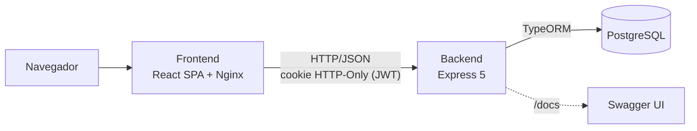
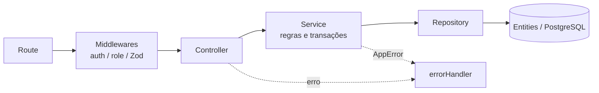
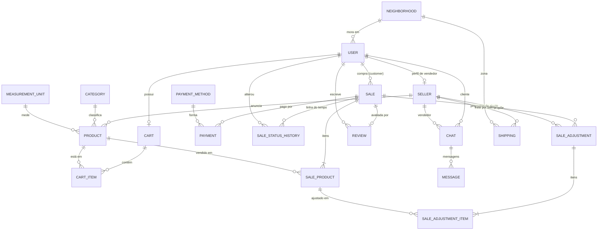
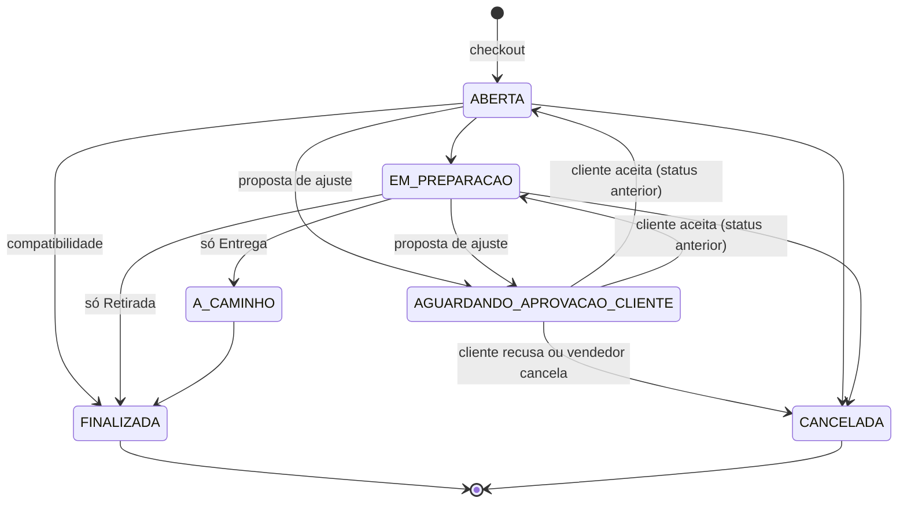

# Arquitetura do Backend — VerdeAr

Este repositório (`VerdeAr/backend`) contém a API RESTful que substitui a camada de backend do monolito legado [`VerdeAr/Verdear`](https://github.com/VerdeAr/Verdear). O frontend consumidor é o repositório irmão [`VerdeAr/frontend`](https://github.com/VerdeAr/frontend).

O VerdeAr é um marketplace que conecta produtores familiares e orgânicos (**Vendedores**) a consumidores (**Clientes**). O glossário e as regras de negócio completas (RN-01 a RN-53) estão no Notion, na página *Regras de Negócio & Glossário*.

---

## 1. Status da migração do monólito

Escopo migrado e ativo:

| Domínio | O que existe |
|---|---|
| Autenticação e perfis | `User` com papel `CLIENTE` ou `VENDEDOR`; `Seller` como perfil estendido (1:1) com CNPJ, nome da fazenda e descrição. Senha com bcrypt, sessão com JWT. |
| Catálogo | `Product`, `Category` e `MeasurementUnit`. Busca pública paginada e CRUD restrito ao vendedor, com estoque e status ativo/inativo. |
| Carrinho | `Cart` e `CartItem` persistidos no banco (um carrinho por usuário), com frete calculado por produtor. |
| Checkout | `Sale`, `SaleProduct` e `Payment` criados em uma transação, com lock pessimista de estoque. |
| Pedidos do vendedor | Listagem filtrável por status, detalhe com linha do tempo, contador de pendentes, máquina de estados (Recebido, Em Preparação, A Caminho, Concluído) com estorno atômico no cancelamento e ajuste de itens com consentimento do cliente (VER-95). |
| Avaliações | Criação por clientes em vendas finalizadas e listagem pública por vendedor ou produto. |
| Documentação | OpenAPI 3.0 com interface em `/docs` e especificação em `/docs.json`, cobrindo todas as rotas ativas. |

Modelado, mas **sem endpoints** hoje: `Shipping` (frete por bairro). A comunicação e tempo real com `Chat` e `Message` está implementada via Socket.io e endpoints REST em `/chats` (VER-58/VER-59).

---

## 2. Stack tecnológica

| Camada | Tecnologia |
|---|---|
| Runtime | Node.js 26 (imagem Docker `node:26-alpine` e CI) + npm |
| Linguagem | TypeScript em modo `strict` (alias `@/*` para `src/*`) |
| Framework HTTP | Express 5 |
| Banco de dados | PostgreSQL (extensão `uuid-ossp`, chaves primárias UUID) |
| ORM | TypeORM, com `synchronize: false` e migrations versionadas |
| Autenticação | `jsonwebtoken` (JWT, 7 dias) + `bcrypt` (10 rounds) |
| Validação | Zod 4, com DTOs inferidos por `z.infer` e `cpf-cnpj-validator` |
| Documentação | `swagger-ui-express` com especificação em `src/config/swagger.ts` |
| Qualidade | Biome (lint e formatação) |
| Testes | Vitest + Supertest (integração, contra um PostgreSQL de testes) |
| Git hooks | Husky + Commitlint (`@commitlint/config-conventional`) |
| Container | Docker multi-stage (`builder` e `runner`), com `HEALTHCHECK` em `/ready` |
| CI/CD | GitHub Actions, imagem no GHCR e Dependabot. Ver [CICD.md](CICD.md) |
| Configuração | `dotenv` |

---

## 3. Visão de sistema



O backend é um serviço único e sem estado de sessão no servidor. A identidade vem do JWT enviado em cada requisição.

---

## 4. Estrutura de pastas

```
src/
├── app.ts             # Monta o Express: CORS, JSON, cookies, logging, Swagger, rotas, errorHandler
├── server.ts          # Inicializa o DataSource e sobe o servidor na PORT
├── config/            # database.ts (DataSource TypeORM) e swagger.ts (OpenAPI)
├── controllers/       # Recebem a requisição, validam com Zod e delegam aos services
├── entities/          # Entidades TypeORM, enums.ts e index.ts
├── errors/            # AppError (mensagem, status HTTP e lista de erros)
├── middlewares/       # auth, validation, logging e error
├── migrations/        # Migrations versionadas
├── repositories/      # Repositórios TypeORM estendidos com queries especializadas
├── routes/            # Uma rota por recurso, agregadas em routes/index.ts
├── schemas/           # Schemas Zod e tipos inferidos
├── seeds/             # initial.seed.ts (dados essenciais, idempotente)
├── services/          # Regras de negócio e transações
└── types/             # express.d.ts (adiciona req.user)
```

Outros arquivos relevantes na raiz: `Dockerfile`, `entrypoint.sh`, `biome.json`, `commitlint.config.mjs`, `.husky/`, `.env.example`.

---

## 5. Camadas e fluxo de uma requisição



1. **Route:** define método, caminho e a cadeia de middlewares.
2. **Middlewares:** `ensureAuthenticated` valida o JWT e preenche `req.user`; `ensureRole([...])` confere o papel; `validate(schema)` aplica Zod ao corpo.
3. **Controller:** extrai e valida parâmetros, query e corpo com Zod e chama o service. Não contém regra de negócio nem acessa o banco.
4. **Service:** concentra as regras, os cálculos e as transações (`AppDataSource.transaction`).
5. **Repository:** único ponto de acesso ao TypeORM, com queries especializadas (`findFiltered`, `findByIdWithDetails` etc.).

A ordem dos middlewares globais em `app.ts` é: CORS, `express.json()`, `cookie-parser`, logging, rotas do Swagger, router principal e, por último, `errorHandler`.

---

## 6. Modelo de dados



Pontos importantes do modelo:

- **Chaves:** todas as tabelas usam `uuid` e têm `created_at` e `updated_at`.
- **Quantidades e preços:** `stock` e `quantity` são `numeric(10,3)` (aceitam frações, como 0,5 kg); `price`, `unit_price`, `total_amount` e `fixed_shipping_rate` são `numeric(10,2)`.
- **Unicidade:** `users.email`, `users.cpf`, `sellers.user_id`, `carts.user_id`, `categories.name`, `measurement_units.name` e `payment_methods.description`. O CNPJ é verificado como único pelo `AuthService`, não por constraint.
- **Enums no banco:** `users_role_enum` (`CLIENTE`, `VENDEDOR`), `carts_delivery_type_enum` e `sales_delivery_type_enum` (`ENTREGA`, `RETIRADA`), `sales_status_enum` (`ABERTA`, `EM_PREPARACAO`, `A_CAMINHO`, `AGUARDANDO_APROVACAO_CLIENTE`, `FINALIZADA`, `CANCELADA`), `sale_adjustments_status_enum` (`PENDENTE`, `ACEITO`, `RECUSADO`) e `chats_status_enum` (`ATIVO`, `FINALIZADO`). O `sales_status_enum` também é usado por `sale_status_history.status` e `sale_adjustments.previous_status`.
- **Histórico de status:** `sale_status_history` guarda cada mudança do pedido (status, data e `changed_by_id`, que é nulo nos registros migrados de pedidos antigos).
- **Ajustes:** `sale_adjustments` guarda a proposta (motivo, vendedor, status, `previous_status` e `responded_at`) e `sale_adjustment_items` guarda a quantidade e o preço originais e propostos de cada item. O índice único parcial `UQ_sale_adjustments_pending_sale` garante **no máximo uma proposta `PENDENTE` por pedido**.
- **Integridade referencial:** `sales.customer_id` e `sale_products.product_id` usam `ON DELETE RESTRICT`, preservando o histórico de pedidos. As demais relações usam `CASCADE` ou `SET NULL`.
- **Avaliação única por venda:** garantida na camada de service; não há constraint `UNIQUE` em `reviews.sale_id`.
- **Frete fixo:** fica em `users.fixed_shipping_rate` (inicia em R$ 0,00 para vendedores). Desde a VER-91, é a **taxa de reserva** de quem ainda não configurou o frete por km.
- **Frete por km (VER-91):** `sellers` guarda a origem (`latitude` e `longitude`, `numeric(10,7)`, nulas = sem origem), `shipping_base_fee` e `shipping_price_per_km` (`numeric(10,2)`, padrão 0, não negativos) e `max_delivery_radius_km` (nulo = sem limite). Constraints `CHECK` garantem as faixas válidas.
- **Frete no pedido (VER-91):** `sales.shipping_amount` (`numeric(10,2)`, padrão 0) e `sales.shipping_distance_km` (nulo quando nenhum produtor cobra por km) são gravados no checkout e não mudam depois. Pedidos anteriores à migration ficam com frete 0, porque o valor real não era registrado.
- **Endereço estruturado (VER-63):** `users` armazena o endereço estruturado em colunas específicas (`zip_code`, `street`, `number`, `complement`, `neighborhood_name`, `city`, `state`) mantendo o campo `address` como fallback. Na resposta da API (`UserResponse`), o texto do bairro vem sempre em `neighborhood_name`, preservando o campo `neighborhood` para o objeto do relacionamento TypeORM.
- **Migrations:** `InitialSchema1790124561841`, `AddStructuredAddressToUsers1790124600000` (VER-63) e `SaleAdjustmentsAndStatusHistory1793827055534` (VER-95: novos status, ajustes, histórico e backfill do histórico dos pedidos existentes) e `AddDynamicShippingFields1794441600000` (VER-91: frete por km no vendedor e frete gravado no pedido), registradas manualmente em `src/config/database.ts`. Novas migrations precisam ser adicionadas à lista `migrations` do DataSource.

---

## 7. Autenticação e autorização

- **Emissão:** `POST /auth/register` e `POST /auth/login` gravam o JWT em um cookie `token` (`httpOnly`, `sameSite: lax`, `secure` apenas em produção, validade de 7 dias). O frontend depende exclusivamente desse cookie (VER-74): o token não fica acessível a JavaScript, então não está em `localStorage` nem em `document.cookie`.
- **Leitura:** `ensureAuthenticated` lê o token do cookie `token`. O cabeçalho `Authorization: Bearer <token>` continua aceito como alternativa para clientes de API. O Swagger declara os dois esquemas (`cookieAuth` e `bearerAuth`); as rotas protegidas aceitam qualquer um.
- **Payload do JWT:** `{ id, role }`, com expiração de 7 dias. Não há refresh token.
- **Resposta de erro:** 401 para token ausente, inválido ou expirado; 403 quando o papel não é permitido.
- **Logout:** `POST /auth/logout` limpa o cookie no servidor. Um token já emitido continua válido até expirar, pois não há revogação.
- **CORS:** origens liberadas por `CORS_ORIGIN` (separadas por vírgula), com `credentials: true`, necessário para o navegador enviar o cookie (`withCredentials` no frontend). Como o cookie é `SameSite=Lax`, frontend e API devem ficar no mesmo site. Sem a variável, o padrão é `localhost:5173`, `localhost:3000` e `127.0.0.1:5173`.

### Matriz de acesso

| Recurso | Público | Cliente | Vendedor |
|---|:-:|:-:|:-:|
| Vitrine (`/produtos`), `/categorias`, `/bairros`, `/unidades-medida` | ✔ | ✔ | ✔ |
| `POST /frete/calcular-rota` (simulação de frete, 30 req/min por IP) | ✔ | ✔ | ✔ |
| Listar avaliações por vendedor ou produto | ✔ | ✔ | ✔ |
| Registro, login e logout | ✔ | ✔ | ✔ |
| `/auth/me`, `/pessoa/cadastro`, `/pessoa/senha` | | ✔ | ✔ |
| Carrinho, checkout, histórico de compras | | ✔ | ✔ |
| Criar avaliação | | ✔ | ✔ |
| `/pessoa/frete` | | | ✔ |
| `/vendedor/produtos` (CRUD, ativar/desativar) | | | ✔ |
| `/vendedor/pedidos` (lista, detalhe, mudança de status e proposta de ajuste) | | | ✔ |
| `POST /vendas/:id/responder-ajuste` (só o cliente da compra) | | ✔ | ✔ |

---

## 8. Regras de negócio implementadas

### Cadastro e perfil
- CPF validado e normalizado para 11 dígitos; e-mail, CPF e CNPJ duplicados retornam 409.
- Senha com no mínimo 6 caracteres. O papel é definido no cadastro; o perfil `Seller` é criado automaticamente para vendedores.
- A troca de senha exige a senha atual correta.

### Catálogo
- A vitrine pública só lista produtos **ativos e com estoque maior que zero** (`disponivel=true` por padrão).
- Busca por nome ou descrição, sem diferenciar maiúsculas e minúsculas. Paginação com `page` e `limit` (padrão 12) e ordenação por `name`, `price` ou `created_at`.
- O detalhe de produto retorna 404 se estiver inativo ou sem estoque e inclui estatísticas de avaliação.
- O vendedor só edita, ativa ou desativa produtos do próprio perfil (403 caso contrário).
- **Exclusão:** o produto é removido do banco; se houver vendas vinculadas (`RESTRICT`), ele é apenas desativado e a API informa isso na resposta.

### Carrinho e frete
- Um carrinho por usuário, criado sob demanda. O preço do item é atualizado ao adicionar ou alterar quantidade.
- Não aceita produto inativo, esgotado ou quantidade acima do estoque.
- O **frete é calculado por produtor** (VER-91) e soma o frete de cada vendedor distinto do carrinho, só na modalidade `ENTREGA`. Em `RETIRADA`, o frete é R$ 0,00.
  - **Produtor com origem configurada:** `taxa base + distância de condução em km × preço por km`, arredondado a 2 casas. A distância vem do OpenRouteService (perfil `driving-car`) entre a origem do produtor e o endereço do cliente, convertido em coordenadas pela geocodificação do próprio ORS. O endereço usado é o estruturado (VER-63) ou, em cadastros antigos, o texto livre `address`.
  - **Produtor sem origem:** vale a taxa fixa `fixed_shipping_rate` (reserva), sem chamar o ORS.
  - **Raio:** destino além de `max_delivery_radius_km` não permite Entrega; o sistema sugere a Retirada.
- **Uma única função de cálculo** (`ShippingService`, em `src/services/shipping.service.ts`) atende o carrinho, o checkout e o `POST /frete/calcular-rota`, então os valores não divergem.
- O carrinho **nunca trava por causa do frete**: se o endereço faltar, o destino estiver fora do raio ou o ORS falhar, ele abre com `shipping_status` (`SEM_ENDERECO`, `FORA_DO_RAIO` ou `INDISPONIVEL`) e `shipping_message`. O checkout recusa a Entrega nesses casos.
- **Integração com o OpenRouteService** (`src/services/routing.service.ts`): chave só em `ORS_API_KEY`, enviada no cabeçalho `Authorization` (nunca na URL nem em log); tempo limite de 8 s; falhas (chave inválida, cota, serviço fora, tempo esgotado) viram `AppError` 503 com mensagem amigável, e rota impossível vira 422; cache em memória de 15 min para rotas e 1 h para geocodificação, para respeitar a cota gratuita (RNF-23). Os logs registram só o tipo da falha, sem endereço ou coordenadas.
- A forma de pagamento preferida é salva no carrinho como texto.

### Checkout
Executado em uma única transação (`SaleService.checkout`):

1. Carrega o carrinho e rejeita carrinho vazio.
2. Define entrega (corpo ou carrinho) e pagamento (corpo, carrinho ou `Dinheiro` como padrão).
3. Para cada item, aplica `pessimistic_write` no produto, valida existência, status ativo e estoque, e decrementa o estoque.
4. Calcula subtotal, frete por produtor e total. O frete é calculado no servidor **antes** de abrir a transação, para a chamada ao OpenRouteService não segurar os bloqueios de estoque; dentro da transação, se o carrinho tiver mudado de produtores, a operação é recusada com 409. Entrega fora do raio de algum produtor é recusada com 400 antes de qualquer alteração.
5. Cria `Sale` (`ABERTA`, com `shipping_amount` e `shipping_distance_km`), a primeira entrada do histórico de status, `SaleProduct` com o preço unitário congelado e `Payment`.
6. Esvazia o carrinho. Qualquer falha desfaz tudo.

### Pedidos
- O vendedor vê apenas pedidos que contêm produtos seus, com o subtotal da sua parte e o total do pedido. A lista indica `has_pending_adjustment`.
- O detalhe (`GET /vendedor/pedidos/:id`) traz só os itens do vendedor, os dados de contato e entrega do cliente (campos selecionados explicitamente, sem senha nem CPF), a forma de pagamento, a linha do tempo e a proposta pendente.
- O contador de pendentes conta os pedidos que pedem ação do vendedor: `ABERTA` e `EM_PREPARACAO`.

#### Máquina de estados

As regras ficam em `services/sale-status.ts`. Só vendedor com produto no pedido altera o status.



- Enviar o status atual não altera nada. Transição fora do diagrama devolve 400.
- `AGUARDANDO_APROVACAO_CLIENTE` só é alcançado pela proposta e só sai pela resposta do cliente ou pelo cancelamento do vendedor (que encerra a proposta como `RECUSADO`).
- Toda mudança grava uma entrada em `sale_status_history` com quem a fez.

#### Concorrência e estoque
- Mudança de status, proposta e resposta bloqueiam a linha do pedido (`pessimistic_write`) antes de ler o status. O lock é feito sem joins, porque o PostgreSQL não aceita `FOR UPDATE` no lado anulável de um `LEFT JOIN`; os itens são carregados depois.
- Isso serializa operações concorrentes no mesmo pedido: o estoque é devolvido **uma única vez** mesmo com cancelamentos simultâneos, e de duas respostas ao ajuste só a primeira vale (a outra recebe 409).
- Os produtos são bloqueados em ordem de ID para evitar deadlock.

#### Ajuste com consentimento (RF-56)
- **Proposta** (`POST /vendedor/pedidos/:id/propor-ajuste`): só em `ABERTA` ou `EM_PREPARACAO` e só nos itens do vendedor. Muda apenas a quantidade (o preço unitário da compra é mantido, RNF-08), sem remover item. Um aumento precisa caber no estoque. O pedido vai a `AGUARDANDO_APROVACAO_CLIENTE` e guarda o `previous_status`; total, pagamento e estoque **não mudam**.
- **Aceite** (`POST /vendas/:id/responder-ajuste` com `aceitar: true`): em uma transação, aplica as quantidades, acerta o estoque pela diferença (falta de estoque devolve 409), recalcula o `total_amount` mantendo o frete, atualiza o `Payment` e volta ao `previous_status`.
- **Recusa** (`aceitar: false`): cancela o **pedido inteiro**, inclusive em pedido com mais de um vendedor, e devolve o estoque de todos os itens.
- O cliente vê a proposta pendente em `pending_adjustment` no histórico de compras e no detalhe da compra. Pedido de outro cliente devolve 404, sem revelar que existe.
- Não há prazo para o cliente responder.

### Avaliações
- Só o cliente dono da venda avalia, apenas vendas `FINALIZADA` e uma vez por venda.

---

## 9. Tratamento de erros e observabilidade

| Situação | Resposta |
|---|---|
| `AppError` (regra de negócio) | Status do erro (400, 401, 403, 404, 409) com `{ success: false, message, errors? }` |
| `ZodError` (validação) | 400 com `message` e `errors: [{ field, message }]` |
| Erro inesperado | 500 com mensagem genérica; o stack trace vai apenas para o log |

- A validação roda em dois estilos: o middleware `validate(schema)` (auth e pessoa) e `schema.parse` dentro dos controllers (produtos, carrinho, vendas, avaliações). Em ambos, o `ZodError` cai no `errorHandler`.
- `loggingMiddleware` registra cada requisição como `[HTTP] MÉTODO URL STATUS - Nms`, com cor por faixa de status.

### Saúde e monitoramento

| Rota | Uso | Resposta |
|---|---|---|
| `GET /health` | Liveness: o processo está de pé. Não consulta o banco. | `200` com `{ status: "ok", uptime }` |
| `GET /ready` | Readiness: a API consegue atender, o que inclui o banco. | `200` com `{ status: "ready", database: "up" }`, ou `503` com `{ status: "unavailable", database: "down" }` |

O `HEALTHCHECK` do `Dockerfile` consulta `/ready`, e o `monitoring.yml` faz o mesmo a cada 15 minutos em cada ambiente; se a API ou o banco ficarem fora do ar, o workflow falha e o GitHub notifica os responsáveis.

---

## 10. Diretrizes arquiteturais

1. **Separação de responsabilidades:** controllers sem regra de negócio nem queries; services com as regras; repositories como único acesso ao TypeORM.
2. **Transações:** operações que alteram várias tabelas ou o estoque usam `DataSource.transaction` com lock pessimista.
3. **Type safety:** `any` é vetado; DTOs vêm dos schemas Zod.
4. **Idioma:** domínio e rotas em português (`/produtos`, `/carrinho`); código e mensagens de erro em português do Brasil.
5. **Segredos:** nada de credenciais no código; tudo via `.env`.
6. **Qualidade:** `npm run check` (`tsc --noEmit` + Biome com `--error-on-warnings`) e `npm test` (testes de integração) devem passar antes de abrir PR; o CI repete as duas verificações e bloqueia o merge se falharem. O hook `pre-commit` roda o Biome em `src/` e o `commit-msg` valida o padrão de commits.
7. **Swagger sempre em dia:** todo endpoint novo ou alterado é documentado em `src/config/swagger.ts`. O teste `tests/swagger.test.ts` valida o documento OpenAPI, confere que `/docs` e `/docs.json` respondem (e que `/api-docs` não existe) e **falha se alguma rota existente ficar sem documentação** ou se o Swagger citar uma rota que não existe mais.

---

## 11. Limitações conhecidas

- **Sem refresh token** e sem revogação de token no logout.
- **Frete por bairro** está modelado, mas sem API.
- **`cart_items`:** a entidade `CartItem` declara `UNIQUE (cart_id, product_id)`, mas a constraint não existe no banco (a `InitialSchema` não a cria). O `migration:generate` sempre a propõe; ela não entrou na migration da VER-95 por estar fora do escopo.
- **`DB_*` e `JWT_SECRET`** usam `process.env` sem validação de presença na inicialização; valores ausentes só falham em tempo de execução. Em `server.ts`, uma falha ao conectar no banco apenas registra o erro, sem encerrar o processo.

---

## 12. Setup local e execução

### Pré-requisitos
- Node.js 22 ou superior (o CI e a imagem Docker usam o Node 26)
- PostgreSQL local ou em container

### Passos
```bash
cp .env.example .env     # ajuste DB_*, JWT_SECRET e CORS_ORIGIN
npm install
npm run migration:run
npm run seed
npm run dev              # http://localhost:3000
```

Documentação interativa: `http://localhost:3000/docs` (especificação OpenAPI em `http://localhost:3000/docs.json`).

### Produção com Docker
O `Dockerfile` compila o TypeScript no estágio `builder` e copia apenas `dist/` e as dependências de produção para o estágio `runner`. O `entrypoint.sh` executa `migration:run` antes de iniciar `node dist/server.js`. O seed **não** roda automaticamente: execute `npm run seed` uma vez em cada ambiente novo.

### Ambientes

| Ambiente | Branch | API | Documentação (Swagger) | Saúde |
|---|---|---|---|---|
| Homologação | `main` | https://api-verdear-dev.pedmesa.com.br | `/docs` | `/ready` |
| Produção | `prod` | https://api-verdear.pedmesa.com.br | `/docs` | `/ready` |

O merge na `main` publica e implanta a homologação; o merge na `prod` faz o mesmo na produção. Os dois só ocorrem com o CI verde. A imagem não carrega configuração de ambiente: banco, segredos e CORS vêm das variáveis do servidor de cada ambiente. Os detalhes estão em [CICD.md](CICD.md).

---

## 13. Fluxo de trabalho

Branches seguem o GitLab Flow (`main` como fonte única; ramos de ambiente recebem código somente a partir do `main`), descrito em [GITFLOW.md](GITFLOW.md), e cada branch usa o ID da própria tarefa (`<tipo>/VER-<ID>-<descricao-curta-em-portugues>`). Commits seguem Conventional Commits, em português, com o mesmo ID e até 100 caracteres (`feat(modulo): [VER-105] cria validacao de pagamento`). O protocolo completo de trabalho com IA está em `.agents/AGENTS.md`. O Pull Request precisa de revisão por pares (os responsáveis estão no arquivo `CODEOWNERS`) e do CI verde (Qualidade, Testes e Commits, descritos em [CICD.md](CICD.md)). O andamento das tarefas está em [ANDAMENTO.md](ANDAMENTO.md).
